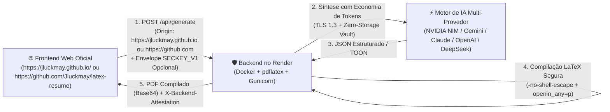
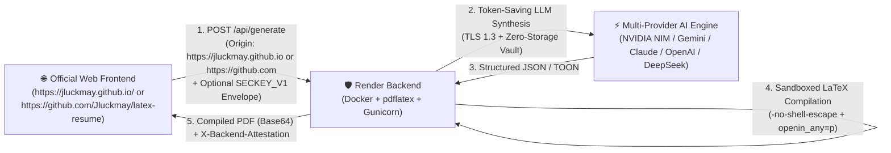

# 📄 Gerador Automático de Currículos LaTeX / Automatic LaTeX Resume Generator (Multi-Provider AI: NVIDIA NIM, Gemini, Claude, OpenAI, DeepSeek)

> 🌐 **Idioma / Language:** [🇧🇷 Português (pt-BR)](#-português-pt-br) | [🇺🇸 English (en-US)](#-english-en-us)

---

## 🇧🇷 Português (`pt-BR`)

Gerador automático de currículos **Acadêmicos** e **Profissionais** em **LaTeX + PDF** (nos idiomas `pt-BR` e `en-US`), alimentado por **Múltiplos Provedores de IA** (**NVIDIA NIM**, **Google Gemini**, **Anthropic Claude**, **OpenAI**, **DeepSeek**) com arquitetura modular de **Plugins de Economia de Tokens**, **Criptografia Efêmera em Navegador (AES-256-GCM)** e **Cofre de Memória Zero-Storage (Task-Bound Enclave)**.

### 📋 Requisitos do Projeto

Para executar o gerador e compilar os currículos em PDF, o ambiente deve atender aos seguintes requisitos obrigatórios:

1. **Compilador LaTeX (`pdflatex`) — Obrigatório**:
   - Distribuição **TeX Live** (2023 ou superior recomendado) ou **MiKTeX** instalada e disponível no `PATH` do sistema.
   - Pacotes LaTeX utilizados pelos templates integrados (incluídos no TeX Live / MiKTeX): `babel` (`brazil` e `english`), `lmodern`, `roboto`, `sourcesanspro`, `raleway`, `fontawesome5`, `tikz`, `multicol`, `tcolorbox`, `adjustbox`, `array`, `fancyhdr`, `geometry`, `xcolor`, `graphicx`, `enumitem`, `titlesec` e `hyperref`.
   - **Instalação rápida do compilador LaTeX**:
     - **Windows (TeX Live ou MiKTeX via Winget)**:
       ```powershell
       winget install -e --id MiKTeX.MiKTeX
       # ou TeX Live completo: https://www.tug.org/texlive/
       ```
     - **Linux (Ubuntu / Debian)**:
       ```bash
       sudo apt update && sudo apt install -y texlive-latex-base texlive-latex-recommended texlive-latex-extra texlive-lang-portuguese texlive-fonts-recommended texlive-fonts-extra
       ```
     - **macOS (Homebrew)**:
       ```bash
       brew install --cask mactex-no-gui
       ```
   - **Verificação do compilador**:
     ```powershell
     pdflatex --version
     # ou via CLI do projeto:
     python cli.py --lang pt-br --check-deps
     ```

2. **Python (`>= 3.10`) e Dependências Python (`requirements.txt`)**:
   - `requests >= 2.31.0`
   - `beautifulsoup4 >= 4.12.0`
   - `Pillow >= 10.0.0`
   - `streamlit >= 1.32.0`
   - `pypdf >= 4.0.0`
   - `flask >= 3.0.0`
   - `cryptography >= 41.0.0`
   - **Instalação**:
     ```powershell
     pip install -r requirements.txt
     ```

### Principais Recursos

1. **Duas Interfaces Web Completas (HTML5 `index.html` + `server.py` e Streamlit `app.py`) com Detecção Automática de Tema e Idioma**:
   - **Design 100% Responsivo & Mobile-First**: interfaces otimizadas para smartphones, tablets e monitores desktop com breakpoints fluidos, ajuste adaptativo de grades (`grid-template-columns`), áreas de toque acessíveis (min 44px) e visualizador de PDF redimensionável dinamicamente (`clamp()`).
   - **Identidade Visual & Ícone Oficial**: logotipo vetorial moderno nos formatos `SVG`, `PNG` (512x512, 192x192, 32x32, 16x16) e `ICO` multi-resolução, integrado na guia do navegador (`favicon`), barra de navegação e cabeçalhos de ambas as interfaces.
   - **Paridade Total de Recursos**: tanto a interface web HTML nativa (`index.html` servida por `python server.py`) quanto a interface Streamlit (`streamlit run app.py`) compartilham um design limpo, agradável e intuitivo com exatamente os mesmos recursos.
   - **Detecção Automática**: detectam automaticamente na inicialização o **idioma padrão** (`navigator.language` / `Accept-Language` ou idioma do SO) e o **tema visual padrão** (`prefers-color-scheme` / registro do SO), adotando-os sem necessidade de configuração manual.
   - **Alternância Instantânea**: incluem seletor rápido entre **☀️ Modo Claro** e **🌙 Modo Escuro** e alternância instantânea entre **Português (`pt-BR`)** e **Inglês (`en-US`)**.
2. **Preview Visual em Tempo Real dos Modelos LaTeX e Customização de Cores**:
   - **Preview Interativo**: exibe uma prévia visual fiel do layout do modelo LaTeX escolhido (`modern_pro`, `academic_classic`, `tech_sidebar`, `minimal_ats`, `overleaf_russell_ti`, `overleaf_awesome_cv`, `overleaf_single_page_keywords`, `google_standard`, `ai_ats_max`) que reflete instantaneamente as cores e o idioma selecionados antes mesmo de compilar o PDF.
   - **Paletas e Seletor de Cores (`HEX`)**: escolha entre 6 paletas executivas/acadêmicas predefinidas (*Azul Oceano*, *Azul Marinho Acadêmico*, *Verde Esmeralda Tech*, *Índigo Real*, *Bordô Clássico*, *Grafite Minimalista*) ou defina manualmente a **Cor Principal** e a **Cor Secundária** aplicadas ao código LaTeX (`\definecolor`).
3. **Coleta Multi-Fonte Automática (incluindo Página de Portfólio)**:
   - **Portfólio Pessoal (`URL`)**: extrai título, descrição, seções (`h1`/`h2`/`h3`), bio e projetos diretamente da página web de portfólio do usuário e adiciona o link clicável **Portfólio** no cabeçalho do PDF.
   - **GitHub**: extrai bio, localização, linguagens principais e repositórios de maior destaque via API REST pública.
   - **ORCID**: extrai biografia, formação (`educations`), vínculos (`employments`) e artigos publicados (`works` com DOI) via API Pública v3.0.
   - **Lattes**: parser nativo para o arquivo oficial `XML`/`ZIP` exportado do CNPq (`CURRICULO-VITAE`), além de suporte a PDF, HTML, URL ou texto complementar.
   - **LinkedIn**: suporte a URL do perfil, upload do PDF oficial exportado pelo LinkedIn (*Salvar como PDF*) e texto complementar.
   - **Foto de Perfil**: normalização automática de imagem (`PNG`/`JPG`/`WebP`) via Pillow para inclusão no LaTeX (`\includegraphics`).
4. **9 Modelos LaTeX Integrados (incluindo Overleaf, Padrão Google e Otimizado para IA & ATS) + Suporte a Template `.tex` Customizado**:
   - `modern_pro`: Moderno Executivo (Profissional & Tech)
   - `academic_classic`: Acadêmico Clássico (Pesquisador / CNPq / Pós-Graduação)
   - `tech_sidebar`: Tech & Engenharia Duas Colunas (Barra Lateral)
   - `minimal_ats`: Minimalista ATS-Friendly (Alta Densidade)
   - `overleaf_russell_ti`: **Overleaf — Currículo T.I. (`russell.cls`)** ([ver no Overleaf](https://www.overleaf.com/read/rgfqqnnynrmv#d5b171)) — Cabeçalho com foto à esquerda, ícones FontAwesome 5, títulos com destaque nas 3 primeiras letras, tabela de skills e barra de proficiência de idiomas (5 pontos).
   - `overleaf_awesome_cv`: **Overleaf — Jason Richards Awesome-CV** ([ver no Overleaf](https://www.overleaf.com/articles/jason-richards-resume/chbxgnfyyvfc)) — Tipografia Roboto + Source Sans Pro, cabeçalho centralizado, títulos com destaque colorido nas 3 primeiras letras e rodapé executivo de 3 colunas.
   - `overleaf_single_page_keywords`: **Overleaf — Single-Page Resume with Keywords (`my_cv.cls`)** ([ver no Overleaf](https://www.overleaf.com/latex/templates/sample-single-page-resume-with-keywords/wmcxcgmtkxzk)) — Fonte Raleway, cabeçalho em 2 colunas, ícones circulares em TikZ + FontAwesome 5, seção Summary em largura total e corpo em 2 colunas com linha de `Keywords` por cargo.
   - `google_standard`: **Padrão Google (Big Tech / Software Engineer)** — Baseado nas diretrizes de recrutamento Big Tech (Google SWE / Gayle Laakmann McDowell). Página única densa, margens de 0.5 polegadas, estrutura XYZ de realizações ("Conquistou [X] medido por [Y], realizando [Z]"), divisórias horizontais limpas e formatação clean sem espaços ociosos.
   - `ai_ats_max`: **Otimizado para IA & ATS (Máxima Legibilidade por LLMs)** — Desenvolvido especificamente para triagem automatizada por LLMs (Gemini, Claude, GPT) e sistemas ATS neurais (Workday, Greenhouse, Lever). Fluxo textual 100% linear em coluna única, metadados semânticos explícitos (tags textuais ASCII: Location, Email, Phone, LinkedIn, GitHub, Portfolio), matriz de competências e palavras-chave (Core Competencies & Keywords) dedicada para match semântico e compatibilidade Unicode nativa (`glyphtounicode`).
    - **Template Customizado (`.tex`)**: envie qualquer arquivo `.tex` próprio e o modelo preencherá a estrutura mantendo o preâmbulo original.
5. **Suporte Multi-Provedor com Chaves Próprias Opcionais e Criptografia em Navegador (Zero-Storage)**:
   - **6 Provedores de IA Suportados**: escolha entre **NVIDIA NIM** (padrão de servidor ou chave própria), **Google Gemini**, **Anthropic Claude**, **OpenAI** e **DeepSeek**, com modelos de última geração e fallback automático.
   - **Criptografia Efêmera no Navegador (`SECKEY_V1`)**: ao inserir uma chave própria na interface web, ela é criptografada e ofuscada em tempo real via **Web Crypto API (AES-256-GCM)** com vetor de inicialização aleatório e derivação dinâmica baseada em timestamp antes de transitar na rede.
   - **Isolamento de Memória & Destruição Imediata (Zero-Storage)**: o backend abre o envelope criptográfico exclusivamente em buffers voláteis na RAM (`src/_vault.py`), despacha a requisição via TLS 1.3 puro e preenche a memória com bytes nulos (`0x00`) no bloco `finally`, expurgando credenciais com `os.environ.pop` para impedir que processos-filhos (como o `pdflatex`) tenham acesso a qualquer segredo.
6. **Política Estrita de Zero-Storage para Documentos Recebidos e Gerados (Sessão Volátil em Memória)**:
   - **Zero Retenção em Disco**: o servidor não armazena currículos gerados (`.pdf`, `.tex`), fotos de perfil enviadas, PDFs do LinkedIn ou arquivos do Lattes. Todos os dados e arquivos são processados exclusivamente na memória volátil durante a requisição ou sessão ativa.
   - **Compilação Efêmera & Destruição Imediata (`finally`)**: a compilação LaTeX ocorre em diretório temporário efêmero isolado (`tempfile.mkdtemp`). Imediatamente após a conversão do PDF para base64/bytes em RAM, todos os arquivos temporários são sobrescritos com bytes nulos (`0x00`) e expurgados via `secure_wipe_and_remove_dir` no bloco `finally:`.
   - **Cache de Tokens Volátil (RAM-Only)**: o cache de tokens opera em memória volátil durante a execução do processo (`in_memory_only=True`), sem gravação de currículos ou prompts em arquivos de disco no servidor.

### 🚀 Publicação no GitHub, GitHub Pages e Backend no Render

O projeto foi arquitetado para separação segura entre Frontend Estático (GitHub Pages) e Backend de Compilação (Render):



#### 1. Hospedagem do Frontend no GitHub Pages (`https://jluckmay.github.io/latex-resume/`)
- Ao fazer push para a branch `main`, o GitHub Actions (`.github/workflows/deploy-pages.yml`) publica automaticamente a interface web (`index.html`) no GitHub Pages.
- O frontend aplica **Content Security Policy (CSP)** estrita e cabeçalhos de atestação de cliente (`X-Resume-Client: jluckmay-github-pages-v1`).

#### 2. Criação do Backend no Render (`Dockerfile` + `render.yaml`)
1. No painel do [Render](https://dashboard.render.com/), selecione **New +** -> **Blueprint** e conecte o repositório do GitHub (ou crie um **Web Service** selecionando runtime **Docker**).
2. O arquivo `render.yaml` configura automaticamente o serviço web com o `Dockerfile` (que inclui TeX Live completo com `pdflatex` e pacotes tipográficos).
3. Na aba **Environment** do serviço no Render, defina a variável de ambiente:
   - `NVIDIA_API_KEY`: sua chave de API da NVIDIA (`nvapi-...`).
4. O backend expõe o endpoint de monitoramento de saúde `/healthz`.

#### 3. Bloqueio Estrito de Conexão Mútua (Exclusivo para `https://github.com/Jluckmay/latex-resume` e `https://jluckmay.github.io/`)
- O backend (`server.py`) rejeita **qualquer conexão** cuja origem ou `Referer` não provenha de `https://github.com/Jluckmay/latex-resume` ou `https://jluckmay.github.io/` (retornando `403 Forbidden`).
- **Chamada direta a partir das páginas autorizadas**:
  Qualquer página ou script hospedado em `https://jluckmay.github.io/` ou no repositório `https://github.com/Jluckmay/latex-resume` pode solicitar a criação de currículos diretamente via `fetch`:
  ```javascript
  const formData = new FormData();
  formData.append("resume_type", "profissional"); // ou "academico"
  formData.append("template_id", "google_standard"); // ou "ai_ats_max", "modern_pro", etc.
  formData.append("github", "octocat");
  formData.append("portfolio", "https://jluckmay.github.io/");

  const response = await fetch("https://latex-resume-backend.onrender.com/api/generate", {
    method: "POST",
    headers: {
      "X-Resume-Client": "jluckmay-github-pages-v1",
      "X-Client-Timestamp": Date.now().toString()
    },
    body: formData
  });
  const data = await response.json();
  // data.pdf_base64 contém o PDF gerado em base64
  ```

### 🔒 Auditoria de Segurança do Projeto & Correções Aplicadas

| Vulnerabilidade Auditada | Risco em Produção | Correção Aplicada |
| :--- | :--- | :--- |
| **Exposição da Chave em Repositório Público** | Bots/scrapers ou usuários extraírem a credencial do código, documentos ou commits do GitHub. | **Política Zero-Secret no Git & Cofre Efêmero Desacoplado**: O repositório Git, commits, documentos e arquivos distribuídos contêm **zero credenciais, zero shards e zero chaves embutidas**. A chave padrão da API é configurada exclusivamente no ambiente privado do backend no Render (`NVIDIA_API_KEY`), fora do Git. Ao iniciar, o `_vault.py` purga a variável de `os.environ` imediatamente (`os.environ.pop`), valida a atestação de chamada (`src/nvidia_client.py` e `src/llm_client.py`), despacha via TLS 1.3 puro e preenche buffers voláteis na memória RAM com zeros (`0x00`) em bloco `finally:`. Os usuários finais do GitHub Pages utilizam a compilação do backend sem jamais ter acesso ou capacidade de recuperar a chave da API. Chaves próprias informadas na interface web trafegam criptografadas com Web Crypto AES-256-GCM (`SECKEY_V1`) e são igualmente destruídas em RAM após a geração. Para uso local independente, as chaves podem ser informadas pelo usuário via variáveis de ambiente, parâmetro `--api-key` ou na interface. |
| **Execução Arbitrária de Código LaTeX (RCE)** | Primitivas `\write18` ou `\directlua` em templates customizados. | **Sanitização Prévia + Isolamento TeX**: bloqueio por regex de comandos do sistema (`\write18`, `\csname`, `\catcode`, `\input{/`). Execução do `pdflatex` com `-no-shell-escape`, ambiente de subprocesso higienizado e parâmetros Web2C `openin_any=p` e `openout_any=p` (impede leitura/escrita de arquivos fora do diretório de compilação). |
| **SSRF (Server-Side Request Forgery)** | Usuário informar URLs de metadados AWS/GCP (`169.254.169.254`) ou rede interna (`127.0.0.1`, `10.0.0.0/8`). | **Validador de IP Público (`_safe_http_get`)**: resolução DNS com verificação `ip.is_global == True`. Bloqueio de loopback, ranges privados e link-local, além de limite de download de 1.5 MB e validação de redirecionamentos. |
| **ZIP Bomb / XXE Bomb (Billion Laughs)** | Upload de ZIP malicioso ou XML com entidades recursivas do Lattes. | Limite estrito de descompressão (15 MB), bloqueio de declarações `<!DOCTYPE` e `<!ENTITY` antes de invocar o parser XML, e limite de 25 MP para fotos com Pillow (`Image.MAX_IMAGE_PIXELS`). |
| **Acesso Não Autorizado ao Backend** | Terceiros usarem o backend no Render para consumir créditos da API. | **Bloqueio Estrito de Origem e Referer**: CORS restrito exclusivamente a `https://github.com/Jluckmay/latex-resume` e `https://jluckmay.github.io`, validação de cabeçalhos mútuos (`X-Resume-Client`, `X-Backend-Attestation`) e Rate Limiting em memória por IP (máx. 15 gerações / 10 min). |

### 🧠 Provedores de IA Suportados & Seleção de Modelos

O gerador suporta múltiplos provedores de inteligência artificial de ponta, permitindo o uso da infraestrutura padrão do servidor ou chaves de API próprias fornecidas pelo usuário:

| Provedor | Modelo Primário Recomendado | Modelos Alternativos / Fallbacks | Características Principais |
| :--- | :--- | :--- | :--- |
| **NVIDIA NIM** *(Padrão / Chave)* | `nvidia/nemotron-3.5-super-vl-120b-a12b` | `stepfun-ai/step-5-preview`, `google/gemma-4-31b-it`, `z-ai/glm-5.3` | 120B MoE (12B ativos), latência < 1.0s, suporte a `enable_thinking: False` (0 tokens ocultos). Padrão do backend. |
| **Google Gemini** *(Chave própria)* | `gemini-2.5-flash` | `gemini-2.5-pro`, `gemini-1.5-pro`, `gemini-1.5-flash` | Altíssima velocidade, raciocínio aprimorado, conformidade estrita com schemas JSON estruturados. |
| **Anthropic Claude** *(Chave própria)* | `claude-3-7-sonnet-20250219` | `claude-3-5-sonnet-20241022`, `claude-3-5-haiku-20241022` | Síntese de perfil executivo e acadêmico impecável, alta precisão textual e vocabulário formal polido. |
| **OpenAI** *(Chave própria)* | `gpt-4o` | `gpt-4o-mini`, `o3-mini`, `gpt-4-turbo` | Modelo emblemático multimodal, consistência determinística em bullet points XYZ e métricas de impacto. |
| **DeepSeek** *(Chave própria)* | `deepseek-chat` (DeepSeek V3) | `deepseek-reasoner` (DeepSeek R1) | Excelente relação custo-benefício, forte desempenho em codificação técnica e resumo curricular estruturado. |

### Plugins de Economia de Tokens (`src/token_plugins.py`)

| Plugin | Função e Impacto na Economia de Tokens |
| :--- | :--- |
| **`CavemanPromptPlugin`** | Aplica diretivas da skill `caveman` (zero preâmbulo, zero cercas markdown, instruções ultra-densas) preservando 100% da qualidade formal (`pt-BR` ou `en-US`) nos textos do currículo (~65% de redução de verbosidade). |
| **`ThinkingSuppressionPlugin`** | Injeta `chat_template_kwargs={"enable_thinking": False}`, reduzindo o gasto com `reasoning_tokens` ocultos para **0 tokens**. |
| **`TOONContextPrunerPlugin`** | Converte os dados brutos de GitHub, ORCID, Lattes, LinkedIn e Portfólio para **TOON (Token-Oriented Object Notation)** e deduplica publicações localmente antes do envio à API. |
| **`ShortKeySchemaPlugin`** | Solicita chaves JSON de 1–2 caracteres (`nm`, `tl`, `xp`, `ed`, `pb`, `sk`) na saída do LLM e expande localmente em Python (~40% menos tokens estruturais). |
| **`LaTeXPreambleSplitPlugin`** | Em templates `.tex` customizados, separa o preâmbulo estático (`\documentclass`...`\begin{document}`) do corpo, evitando que o LLM consuma tokens lendo e reescrevendo pacotes e macros. |
| **`SHA256DiskCachePlugin`** | Cache local por hash SHA-256 em `.cache/nvidia_token_cache.json` (custo de **0 tokens** em reexecuções idênticas). |

### 💻 Guia Completo de Execução Local (`pt-BR`)

Você pode executar o gerador e compilar seus currículos inteiramente na sua máquina local, com máxima velocidade, privacidade e sem necessidade de deploy prévio:

#### 1. Preparação do Ambiente Local
```powershell
# 1. Clonar o repositório
git clone https://github.com/Jluckmay/latex-resume.git
cd latex-resume

# 2. Criar e ativar ambiente virtual Python (recomendado)
python -m venv venv
# Windows:
.\venv\Scripts\Activate.ps1
# Linux / macOS:
source venv/bin/activate

# 3. Instalar dependências Python
pip install -r requirements.txt

# 4. Validar compilador LaTeX instalado
python cli.py --lang pt-br --check-deps
```

#### 2. Configuração de Chaves de API (Multi-Provedor)
Defina a chave de API do provedor desejado no terminal antes da execução (ou informe-a interativamente/via interface gráfica, sem gravação em disco):
```powershell
# NVIDIA NIM (Padrão para execução local com NVIDIA):
$env:NVIDIA_API_KEY = "nvapi-sua-chave-aqui"

# Google Gemini:
$env:GEMINI_API_KEY = "AIzaSy-sua-chave-aqui"

# Anthropic Claude:
$env:ANTHROPIC_API_KEY = "sk-ant-sua-chave-aqui"

# OpenAI:
$env:OPENAI_API_KEY = "sk-sua-chave-aqui"

# DeepSeek:
$env:DEEPSEEK_API_KEY = "sk-sua-chave-aqui"
```
*(No Linux ou macOS, substitua `$env:NOME = "..."` por `export NOME="..."`)*

#### 3. Modos de Execução Disponíveis

##### Modo A: Servidor Web HTML5 Nativo (`server.py`) — Recomendado
Inicia o servidor de compilação local com a interface web estática integrada:
```powershell
python server.py
```
- Acesse no navegador: `http://127.0.0.1:5000`
- O servidor roda em modo de desenvolvimento local com compilação direta via `pdflatex` da sua máquina, sem latência de rede.
- Suporta alternância dinâmica de provedores e inserção de chave de API própria com criptografia Web Crypto AES-256-GCM.

##### Modo B: Interface Interativa Streamlit (`app.py`)
Inicia a interface visual rica do Streamlit com alternância de temas claro/escuro e preview instantâneo:
```powershell
streamlit run app.py
```
- Acesse no navegador: `http://localhost:8501`
- Possui seletor lateral de provedor (`NVIDIA`, `Google`, `Claude`, `OpenAI`, `DeepSeek`), modelos correspondentes, campo de chave segura e prévia interativa dos 9 modelos LaTeX.

##### Modo C: Linha de Comando / CLI (`cli.py`)
Geração rápida e automatizada via terminal, com suporte a seleção de provedores:
```powershell
# Listar todos os provedores e modelos suportados:
python cli.py --list-providers

# Exemplo 1: Currículo Padrão Google com o provedor padrão (NVIDIA NIM)
python cli.py --lang pt-br --type profissional --template google_standard --github octocat --linkedin "https://linkedin.com/in/exemplo" --portfolio "https://jluckmay.github.io/" --output cv_google

# Exemplo 2: Currículo Otimizado para IA & ATS usando Google Gemini (chave lida de $env:GEMINI_API_KEY)
python cli.py --lang pt-br --type profissional --template ai_ats_max --provider google --github octocat --primary-color "#0F4C81" --secondary-color "#1E293B" --output cv_gemini

# Exemplo 3: Currículo Acadêmico usando Anthropic Claude com chave via parâmetro seguro
python cli.py --lang pt-br --type academic --template academic_classic --provider claude --api-key "sk-ant-..." --orcid 0000-0002-1825-0097 --lattes-file examples/sample_lattes.xml --output cv_claude

# Exemplo 4: Currículo usando OpenAI informando a chave via prompt oculto no terminal
python cli.py --lang pt-br --type profissional --template modern_pro --provider openai --github octocat --output cv_openai
```

### 🌐 Guia de Uso da Aplicação Web Online (`https://github.com/Jluckmay/latex-resume`)

A aplicação web pode ser utilizada diretamente pela nuvem através do GitHub Pages e do backend no Render:

#### 1. Acesso à Aplicação Web
- **Repositório Oficial:** [`https://github.com/Jluckmay/latex-resume`](https://github.com/Jluckmay/latex-resume)
- **Página Web Oficial (GitHub Pages):** [`https://jluckmay.github.io/latex-resume/`](https://jluckmay.github.io/latex-resume/) (ou integrada via [`https://jluckmay.github.io/`](https://jluckmay.github.io/))

#### 2. Conectando a Interface Web ao Backend no Render
1. Abra a página web oficial no navegador.
2. No painel de configurações (ícone de engrenagem ou rodapé), verifique o campo **URL do Backend (Render)**:
   - Insira a URL do seu serviço no Render: `https://latex-resume-backend.onrender.com`
3. A interface verifica automaticamente a saúde do serviço (`/healthz`) e a disponibilidade do compilador LaTeX (`/api/status`), exibindo o selo verde com a versão do TeX Live.

#### 3. Chaves de API Próprias Opcionais & Criptografia Efêmera (Zero-Storage)
O projeto permite que os usuários utilizem a chave padrão do servidor ou utilizem **suas próprias chaves de API de forma opcional**, com suporte multi-provedor:
- **⚡ NVIDIA NIM (Padrão do Servidor)**: utiliza a credencial do servidor seguro, sem necessidade de chave do usuário.
- **🟢 NVIDIA NIM (Chave própria)**: `nvapi-...`
- **🔵 Google Gemini (Chave própria)**: `AIzaSy...` (Gemini 2.0 Flash, 1.5 Pro, 1.5 Flash)
- **🟣 Anthropic Claude (Chave própria)**: `sk-ant-...` (Claude 3.5 Sonnet, 3.5 Haiku)
- **🟢 OpenAI (Chave própria)**: `sk-...` (GPT-4o, GPT-4o Mini, o3-mini)
- **🔷 DeepSeek (Chave própria)**: `sk-...` (DeepSeek V3, DeepSeek R1)

##### Protocolo de Proteção e Ofuscação Criptográfica:
1. **Criptografia no Navegador (`SECKEY_V1`):** Ao inserir uma chave própria na interface web, ela é criptografada e ofuscada em tempo real via **Web Crypto API (AES-256-GCM)** com vetor de inicialização aleatório e chave efêmera derivada do timestamp (`SECKEY_V1:...`). A chave em texto plano **nunca** trafega exposta e **nunca** é gravada em `localStorage`, `sessionStorage`, cookies ou logs.
2. **Isolamento Estrito em Memória RAM (`src/_vault.py`):** No backend e em execuções locais, o envelope criptográfico é aberto exclusivamente em memória volátil RAM em buffers `bytearray`.
3. **Zeroização Imediata (Zero-Storage):** Após o disparo da requisição via TLS 1.3 puro com pinning de certificado, o buffer de memória é imediatamente sobrescrito com bytes nulos (`0x00`) no bloco `finally`, e as variáveis de ambiente (`NVIDIA_API_KEY`, `GEMINI_API_KEY`, `ANTHROPIC_API_KEY`, `OPENAI_API_KEY`, `DEEPSEEK_API_KEY`) são expurgadas com `os.environ.pop` para impedir que processos-filhos (como o `pdflatex`) tenham acesso a qualquer credencial.

#### 4. Passo a Passo para Geração do Currículo
1. **Dados Pessoais e Links**: Preencha nome, cargo, e-mail, telefone, localização e informe os links dos seus perfis (GitHub, LinkedIn, ORCID, Portfólio Web, Lattes).
2. **Escolha do Provedor de IA e Modelo**: Selecione o provedor desejado (NVIDIA Padrão, NVIDIA Própria, Google Gemini, Anthropic Claude, OpenAI ou DeepSeek) e o modelo otimizado correspondente. Se desejar, informe sua chave própria com total segurança criptográfica.
3. **Escolha do Modelo LaTeX**: Selecione um dos 9 templates disponíveis:
   - **`google_standard`**: Padrão Google SWE (bullet points XYZ de impacto, alta densidade).
   - **`ai_ats_max`**: Otimizado para triagem por IA (Claude/Gemini/GPT) e robôs ATS neurais.
   - **`overleaf_russell_ti`**: Modelo Overleaf de TI com ícones e barra de habilidades.
   - **`overleaf_awesome_cv`**: Modelo Overleaf Jason Richards Awesome-CV.
   - **`overleaf_single_page_keywords`**: Modelo Overleaf com linha de keywords por cargo.
   - **`modern_pro`**, **`academic_classic`**, **`tech_sidebar`**, **`minimal_ats`** ou seu próprio arquivo `.tex`.
4. **Customização de Cores**: Escolha uma paleta executiva ou insira seus códigos HEX para a Cor Principal e Secundária.
5. **Gerar**: Clique no botão **"Gerar Currículo (PDF + LaTeX)"**.
6. **Visualização e Download**: O PDF compilado é exibido diretamente no visualizador embutido da página, com opção para copiar o código LaTeX fonte ou baixar o arquivo `.pdf` gerado.

#### 5. Restrição Estrita de Comunicação
Por medidas de segurança, o backend no Render aceita conexões e compilações **exclusivamente** das origens:
- `https://github.com/Jluckmay/latex-resume`
- `https://jluckmay.github.io/`

Qualquer solicitação proveniente de outros sites, domínios ou scrapers é automaticamente bloqueada com status `403 Forbidden`.

---

## 🇺🇸 English (`en-US`)

Automatic generator for **Academic** and **Professional** resumes in **LaTeX + PDF** (supporting both `en-US` and `pt-BR`), powered by **Multiple AI Providers** (**NVIDIA NIM**, **Google Gemini**, **Anthropic Claude**, **OpenAI**, **DeepSeek**) with a modular **Token-Saving Plugin Architecture**, **In-Browser Ephemeral Encryption (AES-256-GCM)**, and a **Task-Bound Cryptographic Zero-Storage Enclave Vault**.

### 📋 Project Requirements

To run the generator and compile resumes into PDF, your environment must meet the following mandatory requirements:

1. **LaTeX Compiler (`pdflatex`) — Mandatory**:
   - **TeX Live** (2023+ recommended) or **MiKTeX** distribution installed and available on your system `PATH`.
   - Standard LaTeX packages used by the built-in templates (included in TeX Live / MiKTeX): `babel` (`brazil` and `english`), `lmodern`, `roboto`, `sourcesanspro`, `raleway`, `fontawesome5`, `tikz`, `multicol`, `tcolorbox`, `adjustbox`, `array`, `fancyhdr`, `geometry`, `xcolor`, `graphicx`, `enumitem`, `titlesec`, and `hyperref`.
   - **Quick LaTeX compiler installation**:
     - **Windows (TeX Live or MiKTeX via Winget)**:
       ```powershell
       winget install -e --id MiKTeX.MiKTeX
       # or full TeX Live: https://www.tug.org/texlive/
       ```
     - **Linux (Ubuntu / Debian)**:
       ```bash
       sudo apt update && sudo apt install -y texlive-latex-base texlive-latex-recommended texlive-latex-extra texlive-lang-portuguese texlive-fonts-recommended texlive-fonts-extra
       ```
     - **macOS (Homebrew)**:
       ```bash
       brew install --cask mactex-no-gui
       ```
   - **Verify compiler installation**:
     ```powershell
     pdflatex --version
     # or via the project CLI:
     python cli.py --lang en-us --check-deps
     ```

2. **Python (`>= 3.10`) & Python Dependencies (`requirements.txt`)**:
   - `requests >= 2.31.0`
   - `beautifulsoup4 >= 4.12.0`
   - `Pillow >= 10.0.0`
   - `streamlit >= 1.32.0`
   - `pypdf >= 4.0.0`
   - `flask >= 3.0.0`
   - `cryptography >= 41.0.0`
   - **Installation**:
     ```powershell
     pip install -r requirements.txt
     ```

### Key Features

1. **Two Full-Featured Web Interfaces (Standalone HTML5 `index.html` + `server.py` and Streamlit `app.py`) with Auto Theme & Language Detection**:
   - **100% Fluid Responsive & Mobile-First Layouts**: optimized across smartphones, tablets, and high-DPI desktop viewports with adaptive column wrapping, touch-friendly interactive targets (min 44px), and fluid PDF viewport scaling (`clamp()`).
   - **Official Project Brand & Browser Tab Favicon**: high-definition vector logo provided in `SVG`, `PNG` (512x512, 192x192, 32x32, 16x16), and multi-frame `ICO` formats, appearing in the browser tab (`favicon`), sidebar, and page headers.
   - **Full Feature Parity**: both the standalone HTML5 web interface (`index.html` served via `python server.py`) and the Streamlit interface (`streamlit run app.py`) share a clean, pleasant, and intuitive visual design with identical capabilities.
   - **Automatic Detection**: automatically detects your **default language** (`navigator.language` / `Accept-Language` or OS locale) and **default color scheme** (`prefers-color-scheme` / OS registry theme) on startup and adopts them seamlessly.
   - **Instant Switching**: includes a one-click switcher between **☀️ Light Mode** and **🌙 Dark Mode**, plus instant toggling between **English (`en-US`)** and **Portuguese (`pt-BR`)**.
2. **Real-Time Visual LaTeX Template Preview & Color Customization**:
   - **Interactive Template Preview**: renders a live visual preview of your chosen LaTeX template (`modern_pro`, `academic_classic`, `tech_sidebar`, `minimal_ats`, `overleaf_russell_ti`, `overleaf_awesome_cv`, `overleaf_single_page_keywords`, `google_standard`, `ai_ats_max`) that updates immediately as you tweak colors or switch languages prior to compiling the PDF.
   - **Curated Palettes & `HEX` Color Pickers**: choose from 6 executive/academic presets (*Ocean Blue*, *Academic Navy*, *Emerald Tech*, *Royal Indigo*, *Classic Burgundy*, *Minimalist Charcoal*) or pick custom **Primary** and **Secondary** colors injected directly into LaTeX (`\definecolor`).
3. **Automated Multi-Source Profile Extraction (including Portfolio Websites)**:
   - **Personal Portfolio (`URL`)**: scrapes title, meta description, section headings (`h1`/`h2`/`h3`), bio, and project highlights from your portfolio website and injects a clickable **Portfolio** link in the resume header.
   - **GitHub**: fetches bio, location, top programming languages, and top repositories via the public GitHub REST API.
   - **ORCID**: fetches biography, education history (`educations`), employment affiliations (`employments`), and published works (`works` with DOIs) via the ORCID Public API v3.0.
   - **Lattes**: native parser for official CNPq `XML`/`ZIP` exports (`CURRICULO-VITAE`), plus PDF, HTML, URL, or pasted text support.
   - **LinkedIn**: supports profile URLs, official LinkedIn exported PDFs (*Save to PDF*), and supplementary text.
   - **Profile Photo**: automatic image normalization (`PNG`/`JPG`/`WebP`) via Pillow for seamless LaTeX inclusion (`\includegraphics`).
4. **9 Built-in LaTeX Templates (including Overleaf, Google Standard & AI/ATS-Optimized) + Custom `.tex` Template Support**:
   - `modern_pro`: Executive Modern (Professional & Tech)
   - `academic_classic`: Academic Classic (Researcher / Post-Grad / Faculty)
   - `tech_sidebar`: Tech & Engineering Two-Column (Sidebar)
   - `minimal_ats`: Minimalist ATS-Friendly (High Density)
   - `overleaf_russell_ti`: **Overleaf — IT Resume (`russell.cls`)** ([view on Overleaf](https://www.overleaf.com/read/rgfqqnnynrmv#d5b171)) — Left header photo, FontAwesome 5 icons, 3-letter colored section titles, skill category tables, and 5-dot language proficiency bars.
   - `overleaf_awesome_cv`: **Overleaf — Jason Richards Awesome-CV** ([view on Overleaf](https://www.overleaf.com/articles/jason-richards-resume/chbxgnfyyvfc)) — Roboto + Source Sans Pro typography, centered header, 3-letter colored section titles, and 3-column executive footer.
   - `overleaf_single_page_keywords`: **Overleaf — Single-Page Resume with Keywords (`my_cv.cls`)** ([view on Overleaf](https://www.overleaf.com/latex/templates/sample-single-page-resume-with-keywords/wmcxcgmtkxzk)) — Raleway font, 2-column header, TikZ circled FontAwesome 5 section icons, full-width Summary, and 2-column body with per-role `Keywords` lines.
   - `google_standard`: **Google Standard (Big Tech / Software Engineer)** — Built upon Big Tech recruitment guidelines (Google SWE / Gayle Laakmann McDowell). Dense single-page layout, 0.5-inch margins, XYZ accomplishment format ("Accomplished [X] as measured by [Y], by doing [Z]"), clean horizontal rules, and zero wasted white space.
   - `ai_ats_max`: **AI & ATS Max-Readability (LLM & Neural ATS Evaluators)** — Engineered specifically for automated screening by LLMs (Gemini, Claude, GPT) and neural ATS parsers (Workday, Greenhouse, Lever). Strict 100% linear single-column text stream, explicit semantic ASCII metadata tags (Location, Email, Phone, LinkedIn, GitHub, Portfolio), dedicated Core Competencies & Keywords matrix, and native Unicode mapping (`glyphtounicode`).
   - **Custom Template (`.tex`)**: upload or paste your own `.tex` template and the engine populates the document body while preserving your custom preamble and macros.
5. **Multi-Provider AI Engine with Optional Custom API Keys & Zero-Storage In-Browser Encryption**:
   - **6 Supported AI Providers**: choose between **NVIDIA NIM** (secure server default or custom key), **Google Gemini**, **Anthropic Claude**, **OpenAI**, and **DeepSeek**, featuring state-of-the-art models and automated fallback resilience.
   - **In-Browser Ephemeral Encryption (`SECKEY_V1`)**: custom API keys entered into the web interface are encrypted and obfuscated on-the-fly using the **Web Crypto API (AES-256-GCM)** with a dynamic timestamp-derived key and random IV prior to network transit.
   - **RAM Enclave & Immediate Zeroing (Zero-Storage)**: the backend opens the cryptographic envelope solely within volatile RAM bytearray buffers (`src/_vault.py`), dispatches via pinned TLS 1.3, overwrites memory with null bytes (`0x00`) in `finally:` blocks, and scrubs environment variables with `os.environ.pop` to protect credentials against child processes (such as `pdflatex`).
6. **Strict Zero-Storage Policy for Received and Generated Documents (Volatile In-Memory Session)**:
   - **Zero Disk Retention**: the server never retains generated resumes (`.pdf`, `.tex`), uploaded profile photos, LinkedIn PDFs, or Lattes XMLs on disk. All documents exist strictly in volatile RAM during the active session.
   - **Guaranteed Destruction (`finally`)**: LaTeX compilation executes inside an isolated ephemeral temporary directory (`tempfile.mkdtemp`). As soon as binary assets are read into memory (base64 / bytes), all intermediate files are zero-fill shredded (`0x00`) and unlinked via `secure_wipe_and_remove_dir` in a guaranteed `finally:` block.
   - **Volatile Token Cache (RAM-Only)**: token metrics and caching run exclusively in volatile process memory (`in_memory_only=True`), never written to disk files on the server.

### 🚀 Publishing to GitHub, GitHub Pages & Render Backend

The project is architected for strict separation between the Static Frontend (GitHub Pages) and the LaTeX Compilation Backend (Render):



#### 1. Frontend Hosting on GitHub Pages (`https://jluckmay.github.io/latex-resume/`)
- Pushing to the `main` branch triggers GitHub Actions (`.github/workflows/deploy-pages.yml`) to automatically publish the standalone web UI (`index.html`) to GitHub Pages.
- The frontend enforces a strict **Content Security Policy (CSP)** and mutual client attestation headers (`X-Resume-Client: jluckmay-github-pages-v1`).

#### 2. Backend Deployment on Render (`Dockerfile` + `render.yaml`)
1. In the [Render Dashboard](https://dashboard.render.com/), choose **New +** -> **Blueprint** and connect the repository (or create a **Web Service** selecting the **Docker** runtime).
2. The `render.yaml` specification automatically builds the service with the production `Dockerfile` (containing full TeX Live with `pdflatex` and typography packages).
3. Under the service's **Environment** tab on Render, add the environment variable:
   - `NVIDIA_API_KEY`: your NVIDIA API key (`nvapi-...`).
4. The service exposes the `/healthz` endpoint for zero-downtime health checking.

#### 3. Strict Mutual Communication Lockdown (Exclusive to `https://github.com/Jluckmay/latex-resume` and `https://jluckmay.github.io/`)
- The backend (`server.py`) rejects **any connection** whose `Origin` or `Referer` does not originate from `https://github.com/Jluckmay/latex-resume` or `https://jluckmay.github.io/` (returning `403 Forbidden`).
- **Direct Integration from Authorized Pages**:
  Any page, embed, or script hosted on `https://jluckmay.github.io/` or within the `https://github.com/Jluckmay/latex-resume` repository can request resume compilation directly via standard `fetch`:
  ```javascript
  const formData = new FormData();
  formData.append("resume_type", "professional"); // or "academic"
  formData.append("template_id", "google_standard"); // or "ai_ats_max", "modern_pro", etc.
  formData.append("github", "octocat");
  formData.append("portfolio", "https://jluckmay.github.io/");

  const response = await fetch("https://latex-resume-backend.onrender.com/api/generate", {
    method: "POST",
    headers: {
      "X-Resume-Client": "jluckmay-github-pages-v1",
      "X-Client-Timestamp": Date.now().toString()
    },
    body: formData
  });
  const data = await response.json();
  // data.pdf_base64 contains the generated PDF in base64
  ```

### 🔒 Project Security Audit & Applied Hardening

| Audited Vector | Production Risk | Applied Countermeasure |
| :--- | :--- | :--- |
| **Credential Exposure on Public Git Repo** | Bots/scrapers or repository users extracting credentials from source code, documents, or Git commits. | **Zero-Secret Git Policy & Decoupled Ephemeral Vault**: The public Git repository, commit history, documentation, and distributed files contain **zero credentials, zero shards, and zero embedded keys**. The production API key is configured solely within the Render backend's private environment variables (`NVIDIA_API_KEY`), entirely decoupled from Git. Upon initialization, `_vault.py` purges the variable from `os.environ` immediately (`os.environ.pop`), enforces call-stack attestation (`src/nvidia_client.py` and `src/llm_client.py`), dispatches via strict pinned TLS 1.3, and overwrites all volatile memory buffers with zeros (`0x00`) in a `finally:` block. End users on GitHub Pages compile resumes through the backend without ever having access to or the ability to retrieve the default API key. Custom keys provided in the web interface are encrypted on the client side with Web Crypto AES-256-GCM (`SECKEY_V1`) and are immediately zeroed out in RAM post-generation. For independent local usage, users can supply their own keys via environment variables, the `--api-key` flag, or the UI. |
| **LaTeX Arbitrary Code Execution (RCE)** | `\write18` or `\directlua` primitives inside custom templates. | **Upstream Sanitization + TeX Sandbox**: regex blocking of system commands (`\write18`, `\csname`, `\catcode`, `\input{/`). `pdflatex` runs with `-no-shell-escape`, a sanitized environment, and Web2C parameters `openin_any=p` and `openout_any=p` (preventing file reads outside the ephemeral build directory). |
| **SSRF (Server-Side Request Forgery)** | Malicious URLs targeting cloud metadata (`169.254.169.254`) or internal networks (`127.0.0.1`, `10.0.0.0/8`). | **Public IP Validator (`_safe_http_get`)**: DNS resolution asserting `ip.is_global == True`. Rejection of loopback, private, and link-local ranges, with a 1.5 MB response download cap and safe redirect evaluation. |
| **ZIP Bomb / XXE Bomb (Billion Laughs)** | Malicious ZIP or recursive entity XML uploads via Lattes. | Strict uncompressed size ceiling (15 MB), regex rejection of `<!DOCTYPE` and `<!ENTITY` declarations prior to XML parsing, and 25 MP image cap in Pillow (`Image.MAX_IMAGE_PIXELS`). |
| **Unauthorized Backend Abuse** | Third parties abusing the Render endpoint to drain API tokens. | **Strict Origin & Referer Gate**: CORS restricted exclusively to `https://github.com/Jluckmay/latex-resume` and `https://jluckmay.github.io`, mutual attestation verification (`X-Resume-Client`, `X-Backend-Attestation`), and in-memory sliding-window IP rate limiting (max 15 generations / 10 min). |

### 🧠 Supported AI Providers & Model Selection

The generator supports multiple leading AI providers, accommodating the default server infrastructure as well as user-supplied custom API keys:

| Provider | Recommended Primary Model | Alternative / Fallback Models | Key Characteristics |
| :--- | :--- | :--- | :--- |
| **NVIDIA NIM** *(Default / Custom Key)* | `nvidia/nemotron-3.5-super-vl-120b-a12b` | `stepfun-ai/step-5-preview`, `google/gemma-4-31b-it`, `z-ai/glm-5.3` | 120B MoE (12B active), latency < 1.0s, native `enable_thinking: False` (0 hidden tokens). Backend default. |
| **Google Gemini** *(Custom Key)* | `gemini-2.5-flash` | `gemini-2.5-pro`, `gemini-1.5-pro`, `gemini-1.5-flash` | Ultra-fast throughput, enhanced reasoning, strict adherence to structured JSON schemas. |
| **Anthropic Claude** *(Custom Key)* | `claude-3-7-sonnet-20250219` | `claude-3-5-sonnet-20241022`, `claude-3-5-haiku-20241022` | Flawless executive and academic synthesis, high-precision phrasing, and polished formal prose. |
| **OpenAI** *(Custom Key)* | `gpt-4o` | `gpt-4o-mini`, `o3-mini`, `gpt-4-turbo` | Flagship multimodal model, deterministic consistency for XYZ impact bullet points and metrics. |
| **DeepSeek** *(Custom Key)* | `deepseek-chat` (DeepSeek V3) | `deepseek-reasoner` (DeepSeek R1) | Highly cost-effective, exceptional performance on technical coding backgrounds and structured summaries. |

### Token-Saving Plugins (`src/token_plugins.py`)

| Plugin | Function & Token Economy Impact |
| :--- | :--- |
| **`CavemanPromptPlugin`** | Applies `caveman` skill directives (zero preamble, zero markdown fences, ultra-dense instructions) while keeping final resume prose in polished formal `en-US` or `pt-BR` (~65% verbosity reduction). |
| **`ThinkingSuppressionPlugin`** | Injects `chat_template_kwargs={"enable_thinking": False}`, cutting hidden `reasoning_tokens` overhead down to **0 tokens**. |
| **`TOONContextPrunerPlugin`** | Compresses raw GitHub, ORCID, Lattes, LinkedIn, and Portfolio payloads into **TOON (Token-Oriented Object Notation)** and deduplicates publications locally before calling the API. |
| **`ShortKeySchemaPlugin`** | Uses 1–2 character JSON keys (`nm`, `tl`, `xp`, `ed`, `pb`, `sk`) during LLM generation and expands them locally in Python (~40% fewer structural output tokens). |
| **`LaTeXPreambleSplitPlugin`** | Splits static preambles (`\documentclass`...`\begin{document}`) from custom `.tex` templates so the LLM never spends tokens reading or regenerating package declarations. |
| **`SHA256DiskCachePlugin`** | Local SHA-256 disk cache at `.cache/nvidia_token_cache.json` (**0 API tokens** on repeated runs). |

### 💻 Full Local Execution Guide (`en-US`)

You can run the entire resume generator and compile PDFs locally on your workstation with maximum speed, full privacy, and without cloud deployment:

#### 1. Local Environment Setup
```powershell
# 1. Clone the repository
git clone https://github.com/Jluckmay/latex-resume.git
cd latex-resume

# 2. Create and activate a Python virtual environment (recommended)
python -m venv venv
# Windows:
.\venv\Scripts\Activate.ps1
# Linux / macOS:
source venv/bin/activate

# 3. Install Python dependencies
pip install -r requirements.txt

# 4. Verify local LaTeX compiler installation
python cli.py --lang en-us --check-deps
```

#### 2. Configure API Keys (Multi-Provider)
Set the API key for your desired provider in your terminal before launching (or input it interactively/via the web UI without saving to disk):
```powershell
# NVIDIA NIM (Default for local NVIDIA execution):
$env:NVIDIA_API_KEY = "nvapi-your-key-here"

# Google Gemini:
$env:GEMINI_API_KEY = "AIzaSy-your-key-here"

# Anthropic Claude:
$env:ANTHROPIC_API_KEY = "sk-ant-your-key-here"

# OpenAI:
$env:OPENAI_API_KEY = "sk-your-key-here"

# DeepSeek:
$env:DEEPSEEK_API_KEY = "sk-your-key-here"
```
*(On Linux or macOS, replace `$env:NAME = "..."` with `export NAME="..."`)*

#### 3. Available Execution Modes

##### Mode A: Native Standalone HTML5 Web Server (`server.py`) — Recommended
Launches the local compilation server with the bundled HTML5 web app:
```powershell
python server.py
```
- Open in your browser: `http://127.0.0.1:5000`
- Runs in local development mode with direct compilation via your local `pdflatex`, eliminating network latency.
- Supports live multi-provider switching and custom client-side API keys with Web Crypto AES-256-GCM encryption.

##### Mode B: Interactive Streamlit Web UI (`app.py`)
Launches the rich Streamlit dashboard with light/dark theme toggling and live template previews:
```powershell
streamlit run app.py
```
- Open in your browser: `http://localhost:8501`
- Includes sidebar provider selection (`NVIDIA`, `Google`, `Claude`, `OpenAI`, `DeepSeek`), corresponding models, secure key input, and interactive live previews for all 9 LaTeX templates.

##### Mode C: Command-Line Interface / CLI (`cli.py`)
Fast, scriptable resume generation directly from the terminal, with full multi-provider support:
```powershell
# List all supported AI providers and models:
python cli.py --list-providers

# Example 1: Google Standard Resume with the default provider (NVIDIA NIM)
python cli.py --lang en-us --type professional --template google_standard --github octocat --linkedin "https://linkedin.com/in/example" --portfolio "https://jluckmay.github.io/" --output resume_google

# Example 2: AI & ATS-Optimized Resume using Google Gemini (key read from $env:GEMINI_API_KEY)
python cli.py --lang en-us --type professional --template ai_ats_max --provider google --github octocat --primary-color "#0F4C81" --secondary-color "#1E293B" --output resume_gemini

# Example 3: Academic CV using Anthropic Claude with key supplied via secure parameter
python cli.py --lang en-us --type academic --template academic_classic --provider claude --api-key "sk-ant-..." --orcid 0000-0002-1825-0097 --lattes-file examples/sample_lattes.xml --output resume_claude

# Example 4: Resume using OpenAI prompting for the API key via hidden password prompt
python cli.py --lang en-us --type professional --template modern_pro --provider openai --github octocat --output resume_openai
```

### 🌐 Web Interface & Repository Usage Guide (`https://github.com/Jluckmay/latex-resume`)

The web application can be used directly in the cloud through GitHub Pages paired with your Render backend:

#### 1. Official Access Points
- **Official GitHub Repository:** [`https://github.com/Jluckmay/latex-resume`](https://github.com/Jluckmay/latex-resume)
- **Official Web Page (GitHub Pages):** [`https://jluckmay.github.io/latex-resume/`](https://jluckmay.github.io/latex-resume/) (or integrated via [`https://jluckmay.github.io/`](https://jluckmay.github.io/))

#### 2. Connecting the Web Interface to your Render Backend
1. Open the official web app in any modern browser.
2. In the settings panel (gear icon or footer), check the **Backend URL (Render)** field:
   - Enter your Render backend service URL: `https://latex-resume-backend.onrender.com`
3. The web app automatically performs health probes (`/healthz` and `/api/status`), displaying a green badge indicating the live status and TeX Live compiler version.

#### 3. Optional Custom API Keys & Ephemeral In-Memory Encryption (Zero-Storage Policy)
Users can choose between the secure server-provided default or **provide their own optional API keys**, with multi-provider architecture:
- **⚡ NVIDIA NIM (Server Default)**: Uses the secure server-configured key, no user credential required.
- **🟢 NVIDIA NIM (Own key)**: `nvapi-...`
- **🔵 Google Gemini (Own key)**: `AIzaSy...` (Gemini 2.0 Flash, 1.5 Pro, 1.5 Flash)
- **🟣 Anthropic Claude (Own key)**: `sk-ant-...` (Claude 3.5 Sonnet, 3.5 Haiku)
- **🟢 OpenAI (Own key)**: `sk-...` (GPT-4o, GPT-4o Mini, o3-mini)
- **🔷 DeepSeek (Own key)**: `sk-...` (DeepSeek V3, DeepSeek R1)

##### Cryptographic Protection & Zero-Storage Protocol:
1. **In-Browser Encryption (`SECKEY_V1`):** When entering a custom key in the web interface, it is encrypted and obfuscated in real time via **Web Crypto API (AES-256-GCM)** using an ephemeral dynamic key derived from timestamp and random IV (`SECKEY_V1:...`). Plaintext keys **never** travel exposed and are **never** stored in `localStorage`, `sessionStorage`, cookies, or browser logs.
2. **Strict Volatile RAM Enclave (`src/_vault.py`):** On the backend and in local environments, the cryptographic envelope is unpacked strictly in volatile RAM into zeroable `bytearray` buffers.
3. **Immediate Memory Zeroing (Zero-Storage):** Following the pinned TLS 1.3 HTTPS dispatch, the memory buffer is immediately overwritten with null bytes (`0x00`) in `finally:` blocks. Environment variables (`NVIDIA_API_KEY`, `GEMINI_API_KEY`, `ANTHROPIC_API_KEY`, `OPENAI_API_KEY`, `DEEPSEEK_API_KEY`) are scrubbed with `os.environ.pop` to prevent child processes (such as `pdflatex`) from accessing any credentials.

#### 4. Step-by-Step Resume Generation Workflow
1. **Personal Information & Profile Links**: Input your name, target role, contact info, and provide profile URLs (GitHub, LinkedIn, ORCID, Portfolio Website, Lattes).
2. **Choose AI Provider & Model**: Select your preferred provider (Server Default NVIDIA, Custom NVIDIA, Google Gemini, Anthropic Claude, OpenAI, or DeepSeek) and corresponding model. Optionally enter your own API key with complete cryptographic security.
3. **Choose a LaTeX Template**: Select from the 9 available built-in templates:
   - **`google_standard`**: Google Software Engineer recruitment standard (high-density XYZ accomplishment bullet points).
   - **`ai_ats_max`**: Maximum readability for AI screeners (Claude/Gemini/GPT) and neural ATS filters.
   - **`overleaf_russell_ti`**: Overleaf IT resume with circular icons and skill rating bars.
   - **`overleaf_awesome_cv`**: Overleaf Jason Richards Awesome-CV template.
   - **`overleaf_single_page_keywords`**: Overleaf single-page resume with per-position keywords.
   - **`modern_pro`**, **`academic_classic`**, **`tech_sidebar`**, **`minimal_ats`** or your own uploaded `.tex` file.
4. **Color Customization**: Choose a curated executive palette or input custom HEX colors for primary and secondary accents.
5. **Generate**: Click **"Generate Resume (PDF + LaTeX)"**.
6. **Preview & Download**: The generated PDF renders in the embedded interactive viewer, alongside tabs to inspect or copy the raw `.tex` source code and download the `.pdf` file with a single click.

#### 5. Strict Communication Lockdown
For end-to-end security, the Render backend strictly permits incoming connections and compilation requests **only** from:
- `https://github.com/Jluckmay/latex-resume`
- `https://jluckmay.github.io/`

Any unauthorized request from other origins, third-party sites, or scrapers is immediately rejected with HTTP `403 Forbidden`.

