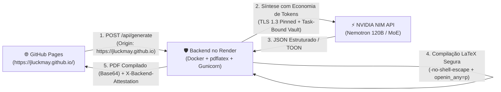

# 📄 Gerador Automático de Currículos LaTeX / Automatic LaTeX Resume Generator (NVIDIA NIM AI)

> 🌐 **Idioma / Language:** [🇧🇷 Português (pt-BR)](#-português-pt-br) | [🇺🇸 English (en-US)](#-english-en-us)

---

## 🇧🇷 Português (`pt-BR`)

Gerador automático de currículos **Acadêmicos** e **Profissionais** em **LaTeX + PDF** (nos idiomas `pt-BR` e `en-US`), alimentado pela API **NVIDIA NIM** com arquitetura modular de **Plugins de Economia de Tokens** e **Cofre Criptográfico Vinculado à Tarefa (Task-Bound Enclave)**.

### 📋 Requisitos do Projeto

Para executar o gerador e compilar os currículos em PDF, o ambiente deve atender aos seguintes requisitos obrigatórios:

1. **Compilador LaTeX (`pdflatex`) — Obrigatório**:
   - Distribuição **TeX Live** (2023 ou superior recomendado) ou **MiKTeX** instalada e disponível no `PATH` do sistema.
   - Pacotes LaTeX utilizados pelos templates integrados (incluídos no TeX Live / MiKTeX): `babel` (`brazil` e `english`), `lmodern`, `roboto`, `sourcesanspro`, `raleway`, `fontawesome5`, `tikz`, `multicol`, `tcolorbox`, `adjustbox`, `array`, `fancyhdr`, `geometry`, `xcolor`, `graphicx`, `enumitem`, `titlesec` e `hyperref`.
   - **Instalação rápida do compilador LaTeX**:
     - **Windows (TeX Live ou MiKTeX via Winget)**:
       ```powershell
       winget install -e --id MiKTeX.MiKTeX
       # ou TeX Live completo: https://www.tug.org/texlive/
       ```
     - **Linux (Ubuntu / Debian)**:
       ```bash
       sudo apt update && sudo apt install -y texlive-latex-base texlive-latex-recommended texlive-latex-extra texlive-lang-portuguese texlive-fonts-recommended texlive-fonts-extra
       ```
     - **macOS (Homebrew)**:
       ```bash
       brew install --cask mactex-no-gui
       ```
   - **Verificação do compilador**:
     ```powershell
     pdflatex --version
     # ou via CLI do projeto:
     python cli.py --lang pt-br --check-deps
     ```

2. **Python (`>= 3.10`) e Dependências Python (`requirements.txt`)**:
   - `requests >= 2.31.0`
   - `beautifulsoup4 >= 4.12.0`
   - `Pillow >= 10.0.0`
   - `streamlit >= 1.32.0`
   - `pypdf >= 4.0.0`
   - `flask >= 3.0.0`
   - **Instalação**:
     ```powershell
     pip install -r requirements.txt
     ```

### Principais Recursos

1. **Duas Interfaces Web Completas (HTML5 `index.html` + `server.py` e Streamlit `app.py`) com Detecção Automática de Tema e Idioma**:
   - **Paridade Total de Recursos**: tanto a interface web HTML nativa (`index.html` servida por `python server.py`) quanto a interface Streamlit (`streamlit run app.py`) compartilham um design limpo, agradável e intuitivo com exatamente os mesmos recursos.
   - **Detecção Automática**: detectam automaticamente na inicialização o **idioma padrão** (`navigator.language` / `Accept-Language` ou idioma do SO) e o **tema visual padrão** (`prefers-color-scheme` / registro do SO), adotando-os sem necessidade de configuração manual.
   - **Alternância Instantânea**: incluem seletor rápido entre **☀️ Modo Claro** e **🌙 Modo Escuro** e alternância instantânea entre **Português (`pt-BR`)** e **Inglês (`en-US`)**.
2. **Preview Visual em Tempo Real dos Modelos LaTeX e Customização de Cores**:
   - **Preview Interativo**: exibe uma prévia visual fiel do layout do modelo LaTeX escolhido (`modern_pro`, `academic_classic`, `tech_sidebar`, `minimal_ats`, `overleaf_russell_ti`, `overleaf_awesome_cv`, `overleaf_single_page_keywords`) que reflete instantaneamente as cores e o idioma selecionados antes mesmo de compilar o PDF.
   - **Paletas e Seletor de Cores (`HEX`)**: escolha entre 6 paletas executivas/acadêmicas predefinidas (*Azul Oceano*, *Azul Marinho Acadêmico*, *Verde Esmeralda Tech*, *Índigo Real*, *Bordô Clássico*, *Grafite Minimalista*) ou defina manualmente a **Cor Principal** e a **Cor Secundária** aplicadas ao código LaTeX (`\definecolor`).
3. **Coleta Multi-Fonte Automática (incluindo Página de Portfólio)**:
   - **Portfólio Pessoal (`URL`)**: extrai título, descrição, seções (`h1`/`h2`/`h3`), bio e projetos diretamente da página web de portfólio do usuário e adiciona o link clicável **Portfólio** no cabeçalho do PDF.
   - **GitHub**: extrai bio, localização, linguagens principais e repositórios de maior destaque via API REST pública.
   - **ORCID**: extrai biografia, formação (`educations`), vínculos (`employments`) e artigos publicados (`works` com DOI) via API Pública v3.0.
   - **Lattes**: parser nativo para o arquivo oficial `XML`/`ZIP` exportado do CNPq (`CURRICULO-VITAE`), além de suporte a PDF, HTML, URL ou texto complementar.
   - **LinkedIn**: suporte a URL do perfil, upload do PDF oficial exportado pelo LinkedIn (*Salvar como PDF*) e texto complementar.
   - **Foto de Perfil**: normalização automática de imagem (`PNG`/`JPG`/`WebP`) via Pillow para inclusão no LaTeX (`\includegraphics`).
4. **7 Modelos LaTeX Integrados (incluindo 3 Templates Oficiais do Overleaf) + Suporte a Template `.tex` Customizado**:
   - `modern_pro`: Moderno Executivo (Profissional & Tech)
   - `academic_classic`: Acadêmico Clássico (Pesquisador / CNPq / Pós-Graduação)
   - `tech_sidebar`: Tech & Engenharia Duas Colunas (Barra Lateral)
   - `minimal_ats`: Minimalista ATS-Friendly (Alta Densidade)
   - `overleaf_russell_ti`: **Overleaf — Currículo T.I. (`russell.cls`)** ([ver no Overleaf](https://www.overleaf.com/read/rgfqqnnynrmv#d5b171)) — Cabeçalho com foto à esquerda, ícones FontAwesome 5, títulos com destaque nas 3 primeiras letras, tabela de skills e barra de proficiência de idiomas (5 pontos).
   - `overleaf_awesome_cv`: **Overleaf — Jason Richards Awesome-CV** ([ver no Overleaf](https://www.overleaf.com/articles/jason-richards-resume/chbxgnfyyvfc)) — Tipografia Roboto + Source Sans Pro, cabeçalho centralizado, títulos com destaque colorido nas 3 primeiras letras e rodapé executivo de 3 colunas.
   - `overleaf_single_page_keywords`: **Overleaf — Single-Page Resume with Keywords (`my_cv.cls`)** ([ver no Overleaf](https://www.overleaf.com/latex/templates/sample-single-page-resume-with-keywords/wmcxcgmtkxzk)) — Fonte Raleway, cabeçalho em 2 colunas, ícones circulares em TikZ + FontAwesome 5, seção Summary em largura total e corpo em 2 colunas com linha de `Keywords` por cargo.
   - **Template Customizado (`.tex`)**: envie qualquer arquivo `.tex` próprio e o modelo preencherá a estrutura mantendo o preâmbulo original.

### 🚀 Publicação no GitHub, GitHub Pages e Backend no Render

O projeto foi arquitetado para separação segura entre Frontend Estático (GitHub Pages) e Backend de Compilação (Render):



#### 1. Hospedagem do Frontend no GitHub Pages (`https://jluckmay.github.io/latex-resume/`)
- Ao fazer push para a branch `main`, o GitHub Actions (`.github/workflows/deploy-pages.yml`) publica automaticamente a interface web (`index.html`) no GitHub Pages.
- O frontend aplica **Content Security Policy (CSP)** estrita e cabeçalhos de atestação de cliente (`X-Resume-Client: jluckmay-github-pages-v1`).

#### 2. Criação do Backend no Render (`Dockerfile` + `render.yaml`)
1. No painel do [Render](https://dashboard.render.com/), selecione **New +** -> **Blueprint** e conecte o repositório do GitHub (ou crie um **Web Service** selecionando runtime **Docker**).
2. O arquivo `render.yaml` configura automaticamente o serviço web com o `Dockerfile` (que inclui TeX Live completo com `pdflatex` e pacotes tipográficos).
3. Na aba **Environment** do serviço no Render, defina a variável de ambiente:
   - `NVIDIA_API_KEY`: sua chave de API da NVIDIA (`nvapi-...`).
4. O backend expõe o endpoint de monitoramento de saúde `/healthz`.

#### 3. Bloqueio Estrito de Conexão Mútua (Exclusivo para `https://jluckmay.github.io/`)
- O backend (`server.py`) rejeita **qualquer conexão** cuja origem não seja `https://jluckmay.github.io` ou cujo `Referer` não inicie por `https://jluckmay.github.io/` (retornando `403 Forbidden`).
- **Chamada direta a partir da sua página principal (`https://jluckmay.github.io/`)**:
  Qualquer página ou script hospedado em `https://jluckmay.github.io/` pode solicitar a criação de currículos diretamente via `fetch`:
  ```javascript
  const formData = new FormData();
  formData.append("resume_type", "profissional"); // ou "academico"
  formData.append("template_id", "modern_pro");
  formData.append("github", "octocat");
  formData.append("portfolio", "https://jluckmay.github.io/");

  const response = await fetch("https://latex-resume-backend.onrender.com/api/generate", {
    method: "POST",
    headers: {
      "X-Resume-Client": "jluckmay-github-pages-v1",
      "X-Client-Timestamp": Date.now().toString()
    },
    body: formData
  });
  const data = await response.json();
  // data.pdf_base64 contém o PDF gerado em base64
  ```

### 🔒 Auditoria de Segurança do Projeto & Correções Aplicadas

| Vulnerabilidade Auditada | Risco em Produção | Correção Aplicada |
| :--- | :--- | :--- |
| **Exposição da Chave em Repositório Público** | Bots/scrapers extraírem a credencial do código git. | **Cofre Efêmero Sem Armazenamento em Disco**: a chave de API **nunca é salva em disco local**, arquivos de configuração ou repositório Git. No Render, a credencial é injetada exclusivamente em tempo de execução via `NVIDIA_API_KEY` nos segredos protegidos do painel. No boot, o `_vault.py` remove a variável de `os.environ` imediatamente (`os.environ.pop`), fatia em shards voláteis na memória RAM com rotação bit-a-bit e sal criptográfico descartável, com atestação de pilha e transporte TLS 1.3 puro com pinning de certificado. Nenhuma API ou endpoint expõe a chave ou seus fragmentos. |
| **Execução Arbitrária de Código LaTeX (RCE)** | Primitivas `\write18` ou `\directlua` em templates customizados. | **Sanitização Prévia + Isolamento TeX**: bloqueio por regex de comandos do sistema (`\write18`, `\csname`, `\catcode`, `\input{/`). Execução do `pdflatex` com `-no-shell-escape`, ambiente de subprocesso higienizado e parâmetros Web2C `openin_any=p` e `openout_any=p` (impede leitura/escrita de arquivos fora do diretório de compilação). |
| **SSRF (Server-Side Request Forgery)** | Usuário informar URLs de metadados AWS/GCP (`169.254.169.254`) ou rede interna (`127.0.0.1`, `10.0.0.0/8`). | **Validador de IP Público (`_safe_http_get`)**: resolução DNS com verificação `ip.is_global == True`. Bloqueio de loopback, ranges privados e link-local, além de limite de download de 1.5 MB e validação de redirecionamentos. |
| **ZIP Bomb / XXE Bomb (Billion Laughs)** | Upload de ZIP malicioso ou XML com entidades recursivas do Lattes. | Limite estrito de descompressão (15 MB), bloqueio de declarações `<!DOCTYPE` e `<!ENTITY` antes de invocar o parser XML, e limite de 25 MP para fotos com Pillow (`Image.MAX_IMAGE_PIXELS`). |
| **Acesso Não Autorizado ao Backend** | Terceiros usarem o backend no Render para consumir créditos da API. | **Bloqueio Estrito de Origem e Referer**: CORS restrito a `https://jluckmay.github.io`, validação de cabeçalhos mútuos (`X-Resume-Client`, `X-Backend-Attestation`) e Rate Limiting em memória por IP (máx. 15 gerações / 10 min). |

### Seleção do Melhor Modelo da API NVIDIA

- **Modelo Primário (`nvidia/nemotron-3.5-super-vl-120b-a12b`)**: arquitetura Mixture-of-Experts de 120B parâmetros (12B ativos), latência média **< 1.0s**, altíssima precisão na geração de JSON/LaTeX e suporte nativo a `enable_thinking: False` (**0 tokens gastos em raciocínio oculto**).
- **Fallbacks Automáticos**: `stepfun-ai/step-5-preview`, `google/gemma-4-31b-it` e `z-ai/glm-5.3`.

### Plugins de Economia de Tokens (`src/token_plugins.py`)

| Plugin | Função e Impacto na Economia de Tokens |
| :--- | :--- |
| **`CavemanPromptPlugin`** | Aplica diretivas da skill `caveman` (zero preâmbulo, zero cercas markdown, instruções ultra-densas) preservando 100% da qualidade formal (`pt-BR` ou `en-US`) nos textos do currículo (~65% de redução de verbosidade). |
| **`ThinkingSuppressionPlugin`** | Injeta `chat_template_kwargs={"enable_thinking": False}`, reduzindo o gasto com `reasoning_tokens` ocultos para **0 tokens**. |
| **`TOONContextPrunerPlugin`** | Converte os dados brutos de GitHub, ORCID, Lattes, LinkedIn e Portfólio para **TOON (Token-Oriented Object Notation)** e deduplica publicações localmente antes do envio à API. |
| **`ShortKeySchemaPlugin`** | Solicita chaves JSON de 1–2 caracteres (`nm`, `tl`, `xp`, `ed`, `pb`, `sk`) na saída do LLM e expande localmente em Python (~40% menos tokens estruturais). |
| **`LaTeXPreambleSplitPlugin`** | Em templates `.tex` customizados, separa o preâmbulo estático (`\documentclass`...`\begin{document}`) do corpo, evitando que o LLM consuma tokens lendo e reescrevendo pacotes e macros. |
| **`SHA256DiskCachePlugin`** | Cache local por hash SHA-256 em `.cache/nvidia_token_cache.json` (custo de **0 tokens** em reexecuções idênticas). |

### Como Executar (`pt-BR`)

```powershell
# 1. Interface Web HTML5 Nativa (index.html + servidor Flask em http://127.0.0.1:5000)
python server.py

# 2. Interface Web Streamlit (app.py)
streamlit run app.py

# 3. CLI — Currículo Profissional com Template Overleaf Russell T.I., Portfólio e Cores Customizadas
python cli.py --lang pt-br --type profissional --template overleaf_russell_ti --github octocat --orcid 0000-0002-1825-0097 --linkedin "https://linkedin.com/in/exemplo" --portfolio "https://meuportfolio.dev" --primary-color "#C0392B" --secondary-color "#1F2937" --photo examples/sample_photo.png --output cv_pt

# 4. CLI — Currículo Acadêmico em Inglês (en-US)
python cli.py --lang en-us --type academic --template academic_classic --orcid 0000-0002-1825-0097 --lattes-file examples/sample_lattes.xml --photo examples/sample_photo.png --output cv_en
```

---

## 🇺🇸 English (`en-US`)

Automatic generator for **Academic** and **Professional** resumes in **LaTeX + PDF** (supporting both `en-US` and `pt-BR`), powered by the **NVIDIA NIM API** with a modular **Token-Saving Plugin Architecture** and a **Task-Bound Cryptographic Enclave Vault**.

### 📋 Project Requirements

To run the generator and compile resumes into PDF, your environment must meet the following mandatory requirements:

1. **LaTeX Compiler (`pdflatex`) — Mandatory**:
   - **TeX Live** (2023+ recommended) or **MiKTeX** distribution installed and available on your system `PATH`.
   - Standard LaTeX packages used by the built-in templates (included in TeX Live / MiKTeX): `babel` (`brazil` and `english`), `lmodern`, `roboto`, `sourcesanspro`, `raleway`, `fontawesome5`, `tikz`, `multicol`, `tcolorbox`, `adjustbox`, `array`, `fancyhdr`, `geometry`, `xcolor`, `graphicx`, `enumitem`, `titlesec`, and `hyperref`.
   - **Quick LaTeX compiler installation**:
     - **Windows (TeX Live or MiKTeX via Winget)**:
       ```powershell
       winget install -e --id MiKTeX.MiKTeX
       # or full TeX Live: https://www.tug.org/texlive/
       ```
     - **Linux (Ubuntu / Debian)**:
       ```bash
       sudo apt update && sudo apt install -y texlive-latex-base texlive-latex-recommended texlive-latex-extra texlive-lang-portuguese texlive-fonts-recommended texlive-fonts-extra
       ```
     - **macOS (Homebrew)**:
       ```bash
       brew install --cask mactex-no-gui
       ```
   - **Verify compiler installation**:
     ```powershell
     pdflatex --version
     # or via the project CLI:
     python cli.py --lang en-us --check-deps
     ```

2. **Python (`>= 3.10`) & Python Dependencies (`requirements.txt`)**:
   - `requests >= 2.31.0`
   - `beautifulsoup4 >= 4.12.0`
   - `Pillow >= 10.0.0`
   - `streamlit >= 1.32.0`
   - `pypdf >= 4.0.0`
   - `flask >= 3.0.0`
   - **Installation**:
     ```powershell
     pip install -r requirements.txt
     ```

### Key Features

1. **Two Full-Featured Web Interfaces (Standalone HTML5 `index.html` + `server.py` and Streamlit `app.py`) with Auto Theme & Language Detection**:
   - **Full Feature Parity**: both the standalone HTML5 web interface (`index.html` served via `python server.py`) and the Streamlit interface (`streamlit run app.py`) share a clean, pleasant, and intuitive visual design with identical capabilities.
   - **Automatic Detection**: automatically detects your **default language** (`navigator.language` / `Accept-Language` or OS locale) and **default color scheme** (`prefers-color-scheme` / OS registry theme) on startup and adopts them seamlessly.
   - **Instant Switching**: includes a one-click switcher between **☀️ Light Mode** and **🌙 Dark Mode**, plus instant toggling between **English (`en-US`)** and **Portuguese (`pt-BR`)**.
2. **Real-Time Visual LaTeX Template Preview & Color Customization**:
   - **Interactive Template Preview**: renders a live visual preview of your chosen LaTeX template (`modern_pro`, `academic_classic`, `tech_sidebar`, `minimal_ats`, `overleaf_russell_ti`, `overleaf_awesome_cv`, `overleaf_single_page_keywords`) that updates immediately as you tweak colors or switch languages prior to compiling the PDF.
   - **Curated Palettes & `HEX` Color Pickers**: choose from 6 executive/academic presets (*Ocean Blue*, *Academic Navy*, *Emerald Tech*, *Royal Indigo*, *Classic Burgundy*, *Minimalist Charcoal*) or pick custom **Primary** and **Secondary** colors injected directly into LaTeX (`\definecolor`).
3. **Automated Multi-Source Profile Extraction (including Portfolio Websites)**:
   - **Personal Portfolio (`URL`)**: scrapes title, meta description, section headings (`h1`/`h2`/`h3`), bio, and project highlights from your portfolio website and injects a clickable **Portfolio** link in the resume header.
   - **GitHub**: fetches bio, location, top programming languages, and top repositories via the public GitHub REST API.
   - **ORCID**: fetches biography, education history (`educations`), employment affiliations (`employments`), and published works (`works` with DOIs) via the ORCID Public API v3.0.
   - **Lattes**: native parser for official CNPq `XML`/`ZIP` exports (`CURRICULO-VITAE`), plus PDF, HTML, URL, or pasted text support.
   - **LinkedIn**: supports profile URLs, official LinkedIn exported PDFs (*Save to PDF*), and supplementary text.
   - **Profile Photo**: automatic image normalization (`PNG`/`JPG`/`WebP`) via Pillow for seamless LaTeX inclusion (`\includegraphics`).
4. **7 Built-in LaTeX Templates (including 3 Official Overleaf Templates) + Custom `.tex` Template Support**:
   - `modern_pro`: Executive Modern (Professional & Tech)
   - `academic_classic`: Academic Classic (Researcher / Post-Grad / Faculty)
   - `tech_sidebar`: Tech & Engineering Two-Column (Sidebar)
   - `minimal_ats`: Minimalist ATS-Friendly (High Density)
   - `overleaf_russell_ti`: **Overleaf — IT Resume (`russell.cls`)** ([view on Overleaf](https://www.overleaf.com/read/rgfqqnnynrmv#d5b171)) — Left header photo, FontAwesome 5 icons, 3-letter colored section titles, skill category tables, and 5-dot language proficiency bars.
   - `overleaf_awesome_cv`: **Overleaf — Jason Richards Awesome-CV** ([view on Overleaf](https://www.overleaf.com/articles/jason-richards-resume/chbxgnfyyvfc)) — Roboto + Source Sans Pro typography, centered header, 3-letter colored section titles, and 3-column executive footer.
   - `overleaf_single_page_keywords`: **Overleaf — Single-Page Resume with Keywords (`my_cv.cls`)** ([view on Overleaf](https://www.overleaf.com/latex/templates/sample-single-page-resume-with-keywords/wmcxcgmtkxzk)) — Raleway font, 2-column header, TikZ circled FontAwesome 5 section icons, full-width Summary, and 2-column body with per-role `Keywords` lines.
   - **Custom Template (`.tex`)**: upload or paste your own `.tex` template and the engine populates the document body while preserving your custom preamble and macros.

### 🚀 Publishing to GitHub, GitHub Pages & Render Backend

The project is architected for strict separation between the Static Frontend (GitHub Pages) and the LaTeX Compilation Backend (Render):


#### 1. Frontend Hosting on GitHub Pages (`https://jluckmay.github.io/latex-resume/`)
- Pushing to the `main` branch triggers GitHub Actions (`.github/workflows/deploy-pages.yml`) to automatically publish the standalone web UI (`index.html`) to GitHub Pages.
- The frontend enforces a strict **Content Security Policy (CSP)** and mutual client attestation headers (`X-Resume-Client: jluckmay-github-pages-v1`).

#### 2. Backend Deployment on Render (`Dockerfile` + `render.yaml`)
1. In the [Render Dashboard](https://dashboard.render.com/), choose **New +** -> **Blueprint** and connect the repository (or create a **Web Service** selecting the **Docker** runtime).
2. The `render.yaml` specification automatically builds the service with the production `Dockerfile` (containing full TeX Live with `pdflatex` and typography packages).
3. Under the service's **Environment** tab on Render, add the environment variable:
   - `NVIDIA_API_KEY`: your NVIDIA API key (`nvapi-...`).
4. The service exposes the `/healthz` endpoint for zero-downtime health checking.

#### 3. Strict Mutual Communication Lockdown (Exclusive to `https://jluckmay.github.io/`)
- The backend (`server.py`) rejects **any connection** whose `Origin` is not `https://jluckmay.github.io` or whose `Referer` does not begin with `https://jluckmay.github.io/` (returning `403 Forbidden`).
- **Direct Integration from your Main Portfolio Page (`https://jluckmay.github.io/`)**:
  Any page or script hosted on `https://jluckmay.github.io/` can request resume compilation directly via standard `fetch`:
  ```javascript
  const formData = new FormData();
  formData.append("resume_type", "professional"); // or "academic"
  formData.append("template_id", "modern_pro");
  formData.append("github", "octocat");
  formData.append("portfolio", "https://jluckmay.github.io/");

  const response = await fetch("https://latex-resume-backend.onrender.com/api/generate", {
    method: "POST",
    headers: {
      "X-Resume-Client": "jluckmay-github-pages-v1",
      "X-Client-Timestamp": Date.now().toString()
    },
    body: formData
  });
  const data = await response.json();
  // data.pdf_base64 contains the generated PDF in base64
  ```

### 🔒 Project Security Audit & Applied Hardening

| Audited Vector | Production Risk | Applied Countermeasure |
| :--- | :--- | :--- |
| **Credential Exposure on Public Git Repo** | Bots/scrapers extracting the key from source code. | **Diskless Ephemeral Vault**: the API key is **never saved to local disk**, configuration files, or the Git repository. On Render, the credential is exclusively injected at runtime via `NVIDIA_API_KEY` in the dashboard's encrypted secrets. At boot, `_vault.py` purges the variable from `os.environ` immediately (`os.environ.pop`), shards volatile bytearrays with bit rotation and disposable cryptographic salt in memory, with call-stack attestation and pinned TLS 1.3 certificate validation. No API or endpoint exposes the key or its fragments. |
| **LaTeX Arbitrary Code Execution (RCE)** | `\write18` or `\directlua` primitives inside custom templates. | **Upstream Sanitization + TeX Sandbox**: regex blocking of system commands (`\write18`, `\csname`, `\catcode`, `\input{/`). `pdflatex` runs with `-no-shell-escape`, a sanitized environment, and Web2C parameters `openin_any=p` and `openout_any=p` (preventing file reads outside the ephemeral build directory). |
| **SSRF (Server-Side Request Forgery)** | Malicious URLs targeting cloud metadata (`169.254.169.254`) or internal networks (`127.0.0.1`, `10.0.0.0/8`). | **Public IP Validator (`_safe_http_get`)**: DNS resolution asserting `ip.is_global == True`. Rejection of loopback, private, and link-local ranges, with a 1.5 MB response download cap and safe redirect evaluation. |
| **ZIP Bomb / XXE Bomb (Billion Laughs)** | Malicious ZIP or recursive entity XML uploads via Lattes. | Strict uncompressed size ceiling (15 MB), regex rejection of `<!DOCTYPE` and `<!ENTITY` declarations prior to XML parsing, and 25 MP image cap in Pillow (`Image.MAX_IMAGE_PIXELS`). |
| **Unauthorized Backend Abuse** | Third parties abusing the Render endpoint to drain API tokens. | **Strict Origin & Referer Gate**: CORS restricted to `https://jluckmay.github.io`, mutual attestation verification (`X-Resume-Client`, `X-Backend-Attestation`), and in-memory sliding-window IP rate limiting (max 15 generations / 10 min). |

### Best NVIDIA NIM Model Selection

- **Primary Model (`nvidia/nemotron-3.5-super-vl-120b-a12b`)**: 120B Mixture-of-Experts (12B active parameters), average latency **< 1.0s**, superior structured JSON/LaTeX compliance, and native support for `enable_thinking: False` (**0 tokens wasted on hidden chain-of-thought**).
- **Automatic Fallbacks**: `stepfun-ai/step-5-preview`, `google/gemma-4-31b-it`, and `z-ai/glm-5.3`.

### Token-Saving Plugins (`src/token_plugins.py`)

| Plugin | Function & Token Economy Impact |
| :--- | :--- |
| **`CavemanPromptPlugin`** | Applies `caveman` skill directives (zero preamble, zero markdown fences, ultra-dense instructions) while keeping final resume prose in polished formal `en-US` or `pt-BR` (~65% verbosity reduction). |
| **`ThinkingSuppressionPlugin`** | Injects `chat_template_kwargs={"enable_thinking": False}`, cutting hidden `reasoning_tokens` overhead down to **0 tokens**. |
| **`TOONContextPrunerPlugin`** | Compresses raw GitHub, ORCID, Lattes, LinkedIn, and Portfolio payloads into **TOON (Token-Oriented Object Notation)** and deduplicates publications locally before calling the API. |
| **`ShortKeySchemaPlugin`** | Uses 1–2 character JSON keys (`nm`, `tl`, `xp`, `ed`, `pb`, `sk`) during LLM generation and expands them locally in Python (~40% fewer structural output tokens). |
| **`LaTeXPreambleSplitPlugin`** | Splits static preambles (`\documentclass`...`\begin{document}`) from custom `.tex` templates so the LLM never spends tokens reading or regenerating package declarations. |
| **`SHA256DiskCachePlugin`** | Local SHA-256 disk cache at `.cache/nvidia_token_cache.json` (**0 API tokens** on repeated runs). |

### How to Run (`en-US`)

```powershell
# 1. Native HTML5 Web UI (index.html + Flask server at http://127.0.0.1:5000)
python server.py

# 2. Streamlit Web UI (app.py)
streamlit run app.py

# 3. CLI — Professional Resume with Portfolio URL & Custom Colors
python cli.py --lang en-us --type professional --template modern_pro --github octocat --orcid 0000-0002-1825-0097 --linkedin "https://linkedin.com/in/example" --portfolio "https://github.blog" --primary-color "#047857" --secondary-color "#064E3B" --photo examples/sample_photo.png --output resume_en

# 4. CLI — Academic CV in English (en-US)
python cli.py --lang en-us --type academic --template academic_classic --orcid 0000-0002-1825-0097 --lattes-file examples/sample_lattes.xml --photo examples/sample_photo.png --output academic_cv_en
```

